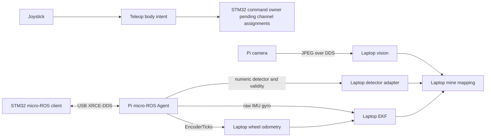

# ROS 2 codebase: ordered file and function reading guide

> **Transport update:** the active firmware now uses direct USB serial and the Pi
> `stm32_bridge` node, without micro-ROS. See [current deployment](STM32_DEPLOYMENT.md)
> and [serial protocol](../firmware/stm32f411/docs/SERIAL_PROTOCOL.md). The detailed
> micro-ROS descriptions below record the previous implementation.

> **Motor update:** `stm32_teleop.py` and `joystick_stm32.launch.py` now implement
> five-channel joystick control for the new MDD10A firmware profile. The original
> motor-disabled image remains the last verified flash. See
> [motor setup](MOTOR_CONTROL_SETUP.md); older statements below about missing
> motor command conversion describe the preceding commissioning implementation.

Prepared for the STM32F411CEU6 architecture, 2026-10-16.

## Start with the actual architecture

The STM32 already contains a micro-ROS client. The Pi's micro-ROS Agent makes
its topics visible to normal ROS 2 applications. The laptop consumes those
native messages for localization and detection; the Pi separately publishes
camera JPEGs. `arduino_bridge.py` is the retained Mega ASCII implementation
and mock simulator, not the STM32 connection.

The five motor roles and two encoder roles remain unassigned (confirmed by the
user during this audit). No Python node currently translates teleop intent into
STM32 MotorCommand. Understanding that missing physical definition does not
require studying embedded code. Do not assume that launching sensors also
implements motor control.

## Vocabulary to use while reading

- **Node:** one ROS participant running callbacks, often one Python process here.
- **Topic / message:** a named data channel and its typed payload. Publishers
  send; subscribers receive. `.msg` files define custom payload structures.
- **Callback:** a function invoked when data, a timer or a service request arrives.
- **Timer:** schedules periodic work; `update()` is a local naming convention,
  not a special ROS language feature.
- **Parameter:** a node's named configuration value, often loaded from YAML.
- **Service:** request/response operation, such as saving the map.
- **QoS:** delivery/history settings. Best effort can drop samples; reliable
  attempts delivery. Native STM32 endpoints use best effort, volatile, depth 1.
- **TF / frame:** named coordinate systems and transformations between them.
- **Odometry:** estimated motion from wheel counts. **EKF:** prediction plus
  uncertainty-weighted correction using odometry and IMU observations.
- **Workspace / package / underlay:** a colcon build directory containing ROS
  packages, a package's source/metadata, and a previously built environment
  sourced before another build. The shared interfaces are the laptop's underlay.
- **`__init__` / `main` / `destroy_node`:** constructor, executable entry point,
  and node cleanup. They appear repeatedly but serve each node's own resources.

## Reading order

Read the numbered files below in order. Each matching section then explains
that exact file and **every locally defined function**, including test fixtures,
methods and nested callbacks. Functions are listed in source order within their
file. Calls into rclpy, OpenCV, NumPy, Tk, CMake and setuptools are external
library APIs, not additional locally defined functions.

This covers all authored source, package/config files, tests, assets and docs
outside firmware, including hidden configuration files. Generated dependency,
build, cache and artifact directories are explained at the end instead of
repeating thousands of generated/vendor files. No firmware file walkthrough
is included.

1. [README.md](../README.md)
2. [pi_ws/README.md](../pi_ws/README.md)
3. [laptop_ws/README.md](../laptop_ws/README.md)
4. [docs/STM32_DEPLOYMENT.md](../docs/STM32_DEPLOYMENT.md)
5. [interfaces/minesweeper_interfaces/msg/MotorCommand.msg](../interfaces/minesweeper_interfaces/msg/MotorCommand.msg)
6. [interfaces/minesweeper_interfaces/msg/MotorStatus.msg](../interfaces/minesweeper_interfaces/msg/MotorStatus.msg)
7. [interfaces/minesweeper_interfaces/msg/EncoderTicks.msg](../interfaces/minesweeper_interfaces/msg/EncoderTicks.msg)
8. [interfaces/minesweeper_interfaces/CMakeLists.txt](../interfaces/minesweeper_interfaces/CMakeLists.txt)
9. [interfaces/minesweeper_interfaces/package.xml](../interfaces/minesweeper_interfaces/package.xml)
10. [pi_ws/src/minesweeper_pi/minesweeper_pi/runtime.py](../pi_ws/src/minesweeper_pi/minesweeper_pi/runtime.py)
11. [laptop_ws/src/minesweeper_laptop/minesweeper_laptop/runtime.py](../laptop_ws/src/minesweeper_laptop/minesweeper_laptop/runtime.py)
12. [pi_ws/src/minesweeper_pi/minesweeper_pi/drive.py](../pi_ws/src/minesweeper_pi/minesweeper_pi/drive.py)
13. [laptop_ws/src/minesweeper_laptop/minesweeper_laptop/teleop.py](../laptop_ws/src/minesweeper_laptop/minesweeper_laptop/teleop.py)
14. [pi_ws/src/minesweeper_pi/minesweeper_pi/camera.py](../pi_ws/src/minesweeper_pi/minesweeper_pi/camera.py)
15. [laptop_ws/src/minesweeper_laptop/minesweeper_laptop/odometry.py](../laptop_ws/src/minesweeper_laptop/minesweeper_laptop/odometry.py)
16. [laptop_ws/src/minesweeper_laptop/minesweeper_laptop/ekf.py](../laptop_ws/src/minesweeper_laptop/minesweeper_laptop/ekf.py)
17. [laptop_ws/src/minesweeper_laptop/minesweeper_laptop/stm32_detector.py](../laptop_ws/src/minesweeper_laptop/minesweeper_laptop/stm32_detector.py)
18. [laptop_ws/src/minesweeper_laptop/minesweeper_laptop/vision.py](../laptop_ws/src/minesweeper_laptop/minesweeper_laptop/vision.py)
19. [laptop_ws/src/minesweeper_laptop/models/best.pt](../laptop_ws/src/minesweeper_laptop/models/best.pt)
20. [laptop_ws/src/minesweeper_laptop/minesweeper_laptop/mapping.py](../laptop_ws/src/minesweeper_laptop/minesweeper_laptop/mapping.py)
21. [laptop_ws/src/minesweeper_laptop/minesweeper_laptop/command_demo.py](../laptop_ws/src/minesweeper_laptop/minesweeper_laptop/command_demo.py)
22. [laptop_ws/src/minesweeper_laptop/minesweeper_laptop/covariance_gui.py](../laptop_ws/src/minesweeper_laptop/minesweeper_laptop/covariance_gui.py)
23. [pi_ws/src/minesweeper_pi/config/pi.yaml](../pi_ws/src/minesweeper_pi/config/pi.yaml)
24. [laptop_ws/src/minesweeper_laptop/config/laptop.yaml](../laptop_ws/src/minesweeper_laptop/config/laptop.yaml)
25. [pi_ws/src/minesweeper_pi/launch/pi.launch.py](../pi_ws/src/minesweeper_pi/launch/pi.launch.py)
26. [pi_ws/src/minesweeper_pi/launch/legacy_pi.launch.py](../pi_ws/src/minesweeper_pi/launch/legacy_pi.launch.py)
27. [laptop_ws/src/minesweeper_laptop/launch/laptop.launch.py](../laptop_ws/src/minesweeper_laptop/launch/laptop.launch.py)
28. [pi_ws/src/minesweeper_pi/minesweeper_pi/arduino_bridge.py](../pi_ws/src/minesweeper_pi/minesweeper_pi/arduino_bridge.py)
29. [pi_ws/src/minesweeper_pi/minesweeper_pi/imu.py](../pi_ws/src/minesweeper_pi/minesweeper_pi/imu.py)
30. [pi_ws/src/minesweeper_pi/minesweeper_pi/motor_controller.py](../pi_ws/src/minesweeper_pi/minesweeper_pi/motor_controller.py)
31. [laptop_ws/src/minesweeper_laptop/minesweeper_laptop/test_joy.py](../laptop_ws/src/minesweeper_laptop/minesweeper_laptop/test_joy.py)
32. [pi_ws/src/minesweeper_pi/minesweeper_pi/__init__.py](../pi_ws/src/minesweeper_pi/minesweeper_pi/__init__.py)
33. [laptop_ws/src/minesweeper_laptop/minesweeper_laptop/__init__.py](../laptop_ws/src/minesweeper_laptop/minesweeper_laptop/__init__.py)
34. [pi_ws/src/minesweeper_pi/package.xml](../pi_ws/src/minesweeper_pi/package.xml)
35. [pi_ws/src/minesweeper_pi/setup.py](../pi_ws/src/minesweeper_pi/setup.py)
36. [pi_ws/src/minesweeper_pi/setup.cfg](../pi_ws/src/minesweeper_pi/setup.cfg)
37. [pi_ws/src/minesweeper_pi/resource/minesweeper_pi](../pi_ws/src/minesweeper_pi/resource/minesweeper_pi)
38. [laptop_ws/src/minesweeper_laptop/package.xml](../laptop_ws/src/minesweeper_laptop/package.xml)
39. [laptop_ws/src/minesweeper_laptop/setup.py](../laptop_ws/src/minesweeper_laptop/setup.py)
40. [laptop_ws/src/minesweeper_laptop/setup.cfg](../laptop_ws/src/minesweeper_laptop/setup.cfg)
41. [laptop_ws/src/minesweeper_laptop/resource/minesweeper_laptop](../laptop_ws/src/minesweeper_laptop/resource/minesweeper_laptop)
42. [laptop_ws/requirements-vision.txt](../laptop_ws/requirements-vision.txt)
43. [scripts/build.sh](../scripts/build.sh)
44. [scripts/build_agent.sh](../scripts/build_agent.sh)
45. [scripts/test.sh](../scripts/test.sh)
46. [pi_ws/src/minesweeper_pi/test/test_drive.py](../pi_ws/src/minesweeper_pi/test/test_drive.py)
47. [pi_ws/src/minesweeper_pi/test/test_serial_bridge.py](../pi_ws/src/minesweeper_pi/test/test_serial_bridge.py)
48. [pi_ws/src/minesweeper_pi/test/test_launch_selection.py](../pi_ws/src/minesweeper_pi/test/test_launch_selection.py)
49. [laptop_ws/src/minesweeper_laptop/test/test_localization.py](../laptop_ws/src/minesweeper_laptop/test/test_localization.py)
50. [laptop_ws/src/minesweeper_laptop/test/test_ekf_parameters.py](../laptop_ws/src/minesweeper_laptop/test/test_ekf_parameters.py)
51. [laptop_ws/src/minesweeper_laptop/test/test_map_teleop.py](../laptop_ws/src/minesweeper_laptop/test/test_map_teleop.py)
52. [laptop_ws/src/minesweeper_laptop/test/test_stm32_telemetry.py](../laptop_ws/src/minesweeper_laptop/test/test_stm32_telemetry.py)
53. [scripts/smoke_test.py](../scripts/smoke_test.py)
54. [scripts/smoke_test_stm32.py](../scripts/smoke_test_stm32.py)
55. [scripts/build_stm32_firmware.sh](../scripts/build_stm32_firmware.sh)
56. [scripts/build_firmware.sh](../scripts/build_firmware.sh)
57. [.gitignore](../.gitignore)
58. [.vscode/settings.json](../.vscode/settings.json)
59. [docs/MIGRATION.md](../docs/MIGRATION.md)
60. [docs/VALIDATION.md](../docs/VALIDATION.md)
61. [docs/READING_GUIDE.md](../docs/READING_GUIDE.md)

## File explanations in the same order

### 1. [README.md](../README.md)

Read this first for the project layout, ROS distribution, build commands, mock demonstration and real STM32 deployment entry point. It distinguishes the current controller from the retained Arduino implementation. No functions: this is documentation.

### 2. [pi_ws/README.md](../pi_ws/README.md)

Explains the Raspberry Pi package and the difference between the hardware-free mock launch, the real micro-ROS Agent launch and the explicitly named legacy launch. It identifies which executables actually run on the Pi. No functions.

### 3. [laptop_ws/README.md](../laptop_ws/README.md)

Explains localization, perception, mapping, joystick and optional displays on the laptop. Build/source the shared interface underlay before this workspace. The `hardware` argument selects the sensor contract; `mock` selects the vision backend. No functions.

### 4. [docs/STM32_DEPLOYMENT.md](../docs/STM32_DEPLOYMENT.md)

Read the STM32 connection architecture without entering the firmware folder. It explains the Agent, source/build order, launch commands, native topic/QoS contracts, prior flash evidence and current limitations. Motor and encoder channel roles remain unassigned; no STM32 motion command conversion exists. No functions.

### 5. [interfaces/minesweeper_interfaces/msg/MotorCommand.msg](../interfaces/minesweeper_interfaces/msg/MotorCommand.msg)

The laptop-to-STM32 command schema. A `.msg` file defines a typed data structure; ROS generates language bindings during the interface build. It contains no executable functions.

- `session`: current challenge reported by status; changes across relevant faults/reconnections.
- `sequence`: nonzero, strictly increasing command number within that session.
- `issued_at_ms`: Unix epoch milliseconds when the command was created, used to reject delayed/replayed commands; this is not ROS simulation time.
- `arm`: explicit arming request, distinct from targets and from the legacy joystick's arm-up actuator code.
- `target[5]`: five channel targets. Configured feedback channels use encoder-shaft rad/s; open-loop channels use signed normalized duty. Channel roles are not assigned.

Understand the zero/disarm → zero/arm handshake before writing any publisher. No current Python node publishes this message to the real controller.

### 6. [interfaces/minesweeper_interfaces/msg/MotorStatus.msg](../interfaces/minesweeper_interfaces/msg/MotorStatus.msg)

The STM32-to-host status schema. No functions.

- `session`, `sequence`: current challenge and last accepted command number.
- `faults`: bit mask: hardware 1, link 2, timeout 4, E-stop 8, feedback 16, invalid command 32, deadline 64, clock 128. Several bits may be set together.
- `uptime_ms`: MCU elapsed milliseconds; a 32-bit value that wraps.
- `armed`, `ready`: current motor state and completed disarm preparation state.
- `hardware_ok`: whether the actual hardware configuration is approved.
- `encoders_valid`, `imu_valid`, `metal_valid`: sensor validity indicators; unavailable streams must not be interpreted as zero readings.
- `duty[5]`: requested signed duty diagnostics, not measured motor voltage.
- `control_stack_free_words`, `uros_stack_free_words`: remaining task stack high-water margins in words.
- `heap_free_bytes`, `heap_min_free_bytes`: current and minimum micro-ROS heap availability.

For Python application study, focus on state and validity first; memory diagnostics can wait.

### 7. [interfaces/minesweeper_interfaces/msg/EncoderTicks.msg](../interfaces/minesweeper_interfaces/msg/EncoderTicks.msg)

One acquisition containing both encoder channels. No functions.

- `stamp`: synchronized ROS epoch acquisition time, used for time differences and freshness.
- `sample_time_ms`: wrap-aware MCU monotonic sampling time, useful for reset/discontinuity detection.
- `ticks[2]`: paired signed 64-bit cumulative counts; they are counts, not meters.
- `velocity_rad_s[2]`: encoder-shaft angular velocities; conversion to wheel/body movement needs confirmed gearing and channel roles.

The native odometry path preserves the count width and acquisition timestamp. The current Python model treats channel 0/1 as left/right by convention; confirm that binding on hardware before interpreting physical movement.

### 8. [interfaces/minesweeper_interfaces/CMakeLists.txt](../interfaces/minesweeper_interfaces/CMakeLists.txt)

Build recipe for the message package. `project` names it; `find_package` locates ament, ROS message generators and builtin time types; `rosidl_generate_interfaces` generates bindings for the three schemas; `ament_export_dependencies` exports runtime requirements; `ament_package` registers the result. These are CMake commands, not locally defined functions. Read this after the schemas so the generation step has a concrete meaning.

### 9. [interfaces/minesweeper_interfaces/package.xml](../interfaces/minesweeper_interfaces/package.xml)

ROS package manifest for the shared messages. It declares ament CMake, build-time ROSIDL generators, runtime bindings and builtin_interfaces; membership in `rosidl_interface_packages` identifies a message-definition package. No functions. Both native and embedded consumers must use the same schemas.

### 10. [pi_ws/src/minesweeper_pi/minesweeper_pi/runtime.py](../pi_ws/src/minesweeper_pi/minesweeper_pi/runtime.py)

Small lifecycle helpers used throughout the Pi package. Read these before node classes: most `main()` functions simply delegate here.

- **`run(factory, args=None)`** (line 6): Takes a node factory and optional ROS arguments, initializes rclpy, constructs the node and spins its callbacks. On Ctrl+C or ROS shutdown it destroys the node and shuts down the ROS context, ensuring subclass hardware cleanup can run.

- **`param(node, name, default)`** (line 21): Declares a parameter with a default on a node and returns its configured value. YAML or command-line overrides take effect at declaration; this helper does not implement live reconfiguration.

### 11. [laptop_ws/src/minesweeper_laptop/minesweeper_laptop/runtime.py](../laptop_ws/src/minesweeper_laptop/minesweeper_laptop/runtime.py)

Same lifecycle pattern, kept in the laptop package so it does not depend on the Pi package. The two copies serve separate installations.

- **`run(factory, args=None)`** (line 6): Initializes ROS, builds the supplied node class, runs callbacks and performs node/context cleanup on exit. Catches normal interruption and external ROS shutdown, while allowing other failures to surface.

- **`param(node, name, default)`** (line 21): Declares a named node parameter and returns its selected value. Callers use it to read startup configuration; EKF covariance tuning separately implements live updates.

### 12. [pi_ws/src/minesweeper_pi/minesweeper_pi/drive.py](../pi_ws/src/minesweeper_pi/minesweeper_pi/drive.py)

Pure drive mathematics plus the old Mega text protocol. Only `wheel_speeds` is general differential-drive math; motor wiring signs and ASCII framing describe the retained hardware. None of this is a micro-ROS transport.

- **`wheel_speeds(linear, angular, track_width=0.55, max_speed=1.0)`** (line 5): Takes body forward speed, angular speed, track width and a wheel-speed limit. Computes left = v − omega·track/2 and right = v + omega·track/2, then scales both equally if either exceeds the limit; invalid/nonfinite movement becomes zero, while nonpositive geometry/limits raise an error. Returns left/right linear wheel speeds in m/s.

- **`motor_duties(left, right, max_speed=1.0)`** (line 18): Converts left/right linear speeds to signed percentages in the inherited FR, FL, RL, RR wiring order. Right-channel signs are inverted for the old wiring; these signs must not be applied to unassigned STM32 channels.

- **`parse_telemetry(line)`** (line 25): Accepts a bounded Mega ASCII line `T,left,right,metal`, validates field count, signed Int32 encoder ranges and binary metal value, and returns `(left, right, bool)`. Malformed or oversized input raises ValueError; it never evaluates input as Python code.

- **`encode_command(linear, angular, controller)`** (line 38): Validates the old numeric controller code and returns ASCII bytes `C,linear,angular,controller\n`. Converts nonfinite speed input to zero. This is exclusively the Mega protocol, which the STM32 micro-ROS firmware does not accept.

### 13. [laptop_ws/src/minesweeper_laptop/minesweeper_laptop/teleop.py](../laptop_ws/src/minesweeper_laptop/minesweeper_laptop/teleop.py)

Converts standard joystick messages into body velocity and legacy actuator commands. `/cmd_vel` is movement intent, not a direct STM32 motor command. This node does not implement the STM32 session/sequence/arming contract.

- **`axis_value(axes, index, deadzone)`** (line 14): Reads a joystick axis safely by index, returning zero for missing/nonfinite input. Clamps valid input to [-1, 1] and applies a deadzone; callers then multiply it by speed settings.

- **`Teleop.__init__(self)`** (line 22): Reads axis/button mappings, scales, deadzone and timeout; validates basic settings; creates `/cmd_vel` and `/controller` publishers, a sensor-QoS `/joy` subscription and a 20 Hz update timer. Starts with no fresh enabled controller input.

- **`Teleop.pressed(buttons, index)`** (line 46): Static helper that checks whether a button index exists and its value is nonzero. Missing buttons are safely treated as released.

- **`Teleop.on_joy(self, msg)`** (line 49): Saves the newest joystick state and receipt time. While the deadman button is held, rising button edges publish release/hold/speed codes, adjust the local speed scale and update the previous-button state so a held button does not repeat an edge action.

- **`Teleop.update(self)`** (line 63): At each timer tick, publishes zero velocity unless input is fresh and the deadman is held. Otherwise scales the selected axes into linear/angular velocity and sends arm-up 7, arm-down 8 or stop 9 according to mutually exclusive button states.

- **`main(args=None)`** (line 75): Starts a Teleop node through the shared lifecycle helper. The launch file controls whether this optional command publisher is enabled.

### 14. [pi_ws/src/minesweeper_pi/minesweeper_pi/camera.py](../pi_ws/src/minesweeper_pi/minesweeper_pi/camera.py)

Pi-side image capture and JPEG publication over DDS. In mock mode it draws a red circle into a synthetic image; the laptop mock detector recognizes that circle. In real STM32 deployment this remains a separate Linux camera process.

- **`Camera.__init__(self)`** (line 11): Loads image size, rate, quality, frame label and mock settings, validating positive dimensions and JPEG range. Opens and configures OpenCV capture only in real mode; creates the compressed-image publisher and timer, with an optional mock visibility subscription.

- **`Camera.set_visible(self, msg)`** (line 37): Stores the injected Boolean determining whether the synthetic mine should appear in future mock frames. It has no effect on real camera capture.

- **`Camera.update(self)`** (line 40): Creates a mock frame or reads one physical camera frame. Encodes successful frames to JPEG and publishes a timestamped `CompressedImage` with format `jpeg`; a failed read logs a warning and emits no replacement frame.

- **`Camera.destroy_node(self)`** (line 59): Releases the physical camera handle if opened, then delegates ROS entity cleanup to Node. This prevents device handles remaining owned after shutdown.

- **`main(args=None)`** (line 65): Runs the Camera node with the shared lifecycle helper. This is the `ros2 run minesweeper_pi camera` entry point.

### 15. [laptop_ws/src/minesweeper_laptop/minesweeper_laptop/odometry.py](../laptop_ws/src/minesweeper_laptop/minesweeper_laptop/odometry.py)

Turns encoder movement into an encoder-only estimate of x, y, heading and velocity. It contains a pure mathematical model and a ROS wrapper. The legacy path receives separate Int32 topics; `encoder_source=stm32` receives a single paired native message with 64-bit counts. The EKF, not odometry, owns body TF by default.

Example: once a baseline is received, +3800 left and +2255 right counts mean one meter forward using the inherited scales. Physical STM32 scales and left/right bindings still require measurement.

- **`normalize(angle)`** (line 16): Wraps an angle in radians to the principal interval using atan2(sin(angle), cos(angle)). This avoids heading discontinuities growing without bound.

- **`yaw(q)`** (line 20): Extracts planar yaw in radians from a quaternion's x/y/z/w components. Callers must supply a meaningful orientation; the EKF separately checks IMU quaternion validity.

- **`quaternion(theta)`** (line 24): Converts planar yaw into a normalized ROS Quaternion using z = sin(theta/2) and w = cos(theta/2). Roll and pitch remain zero.

- **`tick_delta(current, previous, bits=32)`** (line 28): Returns a signed modular difference between cumulative counts, using 32 bits by default or 64 for native STM32 data. Casts generated NumPy scalar inputs to Python ints first, preventing intermediate C integer overflow. Correct interpretation assumes actual intersample movement is less than half the counter range.

- **`WheelOdometry.__init__(self, ticks_left=3800.0, ticks_right=2255.0, track=0.55, counter_bits=32)`** (line 35): Validates positive left/right counts per meter and track width. Stores counter width, clears the encoder baseline and initializes x/y/heading to zero; the model does not open ROS or hardware.

- **`WheelOdometry.update(self, left, right, dt)`** (line 43): Takes cumulative left/right counts and elapsed seconds. The first pair establishes a baseline with no motion; nonpositive dt does not consume subsequent ticks. Converts modular count differences to distances, integrates an exact constant-curvature arc with a stable straight-line limit, and returns `(v, omega, left_distance, right_distance)` while updating pose.

- **`OdometryNode.__init__(self)`** (line 62): Selects legacy or STM32 input, builds the model with matching counter width, reads frame/geometry/rate parameters and creates pose, odometry, distance and TF outputs. STM32 subscribes best-effort depth 1 to `/encoders/ticks`; legacy subscribes to both Int32 topics and integrates on a timer.

- **`OdometryNode.on_encoders(self, msg)`** (line 94): Processes one paired STM32 acquisition: rejects zero, old or excessively future timestamps; detects MCU uptime rollback and interrupted streams; establishes a new count baseline after a reset/gap. Rejects duplicate/out-of-order accepted stamps, computes dt from acquisition times, updates the 64-bit model and publishes with the original stamp. A reset/gap retains the existing pose but drops movement across the unknown interval.

- **`OdometryNode.on_left(self, msg)`** (line 115): Stores the latest legacy left count and marks that side as newly received. No integration occurs until a fresh right sample is also available.

- **`OdometryNode.on_right(self, msg)`** (line 118): Stores the latest legacy right count and marks that side fresh. This complements on_left so timer processing does not repeatedly integrate a partial pair.

- **`OdometryNode.update(self)`** (line 121): Legacy-only timer callback: waits for a new sample from each side, clears freshness flags, computes elapsed ROS time and updates the drive model. Calls the common publication method with the current host timestamp.

- **`OdometryNode.publish_odometry(self, stamp, v, w, dl, dr)`** (line 131): Packages the model pose and supplied v/omega/distances into `/odom`, `/robot_2d` and `/encoder_dist`, with covariance entries. Optionally broadcasts odom→base_link when explicitly enabled; normally the EKF alone owns that transform.

- **`main(args=None)`** (line 153): Runs OdometryNode through the shared lifecycle helper. Its startup `encoder_source` parameter comes from the laptop launch hardware selection.

### 16. [laptop_ws/src/minesweeper_laptop/minesweeper_laptop/ekf.py](../laptop_ws/src/minesweeper_laptop/minesweeper_laptop/ekf.py)

Five-state extended Kalman filter: state `[x, y, yaw, v, omega]`, covariance `p`. Prediction estimates motion between measurements; correction combines measurements according to their variances. Larger variance means less trust. Wheel odometry and IMU gyro are consumed independently; raw STM32 IMU orientation is correctly marked absent.

- **`ExtendedKalmanFilter.__init__(self)`** (line 20): Creates a zero five-element state vector and identity covariance matrix. These are the filter's mathematical state and uncertainty, independent of ROS publishers.

- **`ExtendedKalmanFilter.predict(self, dt)`** (line 24): For positive dt, propagates position using midpoint heading and advances yaw using angular speed. Builds the motion Jacobian, propagates covariance and adds time-scaled process noise; nonpositive dt is ignored.

- **`ExtendedKalmanFilter.correct(self, values, indices, variances)`** (line 39): Takes measured values, their state indices and positive variances. Rejects nonfinite values/nonpositive variances, wraps heading residuals, solves for Kalman gain, corrects the state and updates covariance with the Joseph form, then symmetrizes it. Returns whether correction was accepted.

- **`EkfNode.__init__(self)`** (line 61): Creates the filter, frame/time/variance settings, parameter validation/application callbacks, odometry and sensor-QoS IMU subscriptions, filtered odometry/pose publishers and a 20 Hz timer. By default this node broadcasts odom→base_link.

- **`EkfNode.validate_parameters(self, parameters)`** (line 85): Pre-validates live covariance changes: odom_variances must be five positive finite doubles and imu_variances two. Returns SetParametersResult; an invalid member rejects an atomic parameter request before application.

- **`EkfNode.apply_parameters(self, parameters)`** (line 95): After ROS accepts a parameter change, copies supported covariance arrays into the active node fields. It keeps the filter's measurement weighting consistent with the ROS parameter values.

- **`EkfNode.on_odom(self, msg)`** (line 100): Rejects non-increasing acquisition stamps, extracts x/y/yaw/v/omega into a pending correction and records receipt time for the motion timeout. A newer pending sample replaces the older one; each consumed measurement is applied once.

- **`EkfNode.on_imu(self, msg)`** (line 110): Rejects non-increasing stamps and builds a pending correction only for available IMU components. Uses yaw only if orientation covariance does not flag absence and the quaternion is near unit length; uses angular z when rate covariance allows it. STM32 raw IMU therefore contributes gyro rate without inventing an orientation.

- **`EkfNode.update(self)`** (line 127): Computes elapsed ROS time, zeros velocity states when wheel odometry has expired, predicts with a bounded dt and consumes pending odometry/IMU corrections once. Publishes filtered pose, twist and covariance plus optional body TF. Fresh IMU correction can still affect angular speed after an odometry timeout; this is estimation, not a motion controller.

- **`main(args=None)`** (line 166): Runs EkfNode using the shared lifecycle helper. The laptop launch remaps its IMU input to `/imu/data_raw` for STM32 hardware.

### 17. [laptop_ws/src/minesweeper_laptop/minesweeper_laptop/stm32_detector.py](../laptop_ws/src/minesweeper_laptop/minesweeper_laptop/stm32_detector.py)

Small laptop compatibility adapter: the STM32 publishes a numeric detector signal, while mapping expects Boolean `/detection`. It uses native best-effort status/signal inputs and reliable Boolean output. It never converts silence into a negative observation.

- **`Stm32Detector.__init__(self)`** (line 14): Reads a finite threshold and positive finite status timeout, starts with unknown validity, and creates `/motor/status` and `/metal_detector/signal` subscriptions plus the mapper-compatible `/detection` publisher. The default 0.5 threshold is appropriate for digital 0/1, not an uncalibrated ADC.

- **`Stm32Detector.on_status(self, msg)`** (line 27): Stores the latest metal_valid flag and its monotonic receipt time. Motor arming is not required merely to observe a valid sensor.

- **`Stm32Detector.on_signal(self, msg)`** (line 31): Publishes whether the finite signal meets the threshold only while the latest status is recent and says the detector is valid. Otherwise emits nothing; mapping's own freshness window prevents old positives being used indefinitely.

- **`main(args=None)`** (line 37): Runs the adapter using the shared lifecycle helper. It is enabled by `hardware:=stm32` in the laptop launch.

### 18. [laptop_ws/src/minesweeper_laptop/minesweeper_laptop/vision.py](../laptop_ws/src/minesweeper_laptop/minesweeper_laptop/vision.py)

Consumes compressed images and publishes mine presence, gripper-line alignment and an annotated image. Mock processing recognizes synthetic red pixels; real processing uses the bundled YOLO checkpoint. Neither path autonomously actuates a gripper.

- **`Vision.__init__(self)`** (line 15): Loads confidence, image timeout, optional display/flip, alignment line, device and class settings. Loads Ultralytics/weights only outside mock mode; sets up sensor-QoS image input, detection/alignment/overlay publishers and a timer with one pending frame slot.

- **`Vision.image(self, msg)`** (line 43): Checks the received image's ROS timestamp against the freshness window and bounds its compressed size to 4 MiB. Stores only an acceptable newest frame, replacing a previous pending frame so inference cannot build an unbounded queue.

- **`Vision.update(self)`** (line 49 in the initial port): Decodes the pending JPEG, optionally flips it, and detects either red synthetic pixels or YOLO boxes. Computes whether any box reaches the clamped alignment line, draws the overlay and publishes an annotated JPEG. Publishes Boolean detection/alignment every tick, clearing their effective values when the source image becomes stale. `/camera/ready` separately identifies fresh successfully processed input so the mapper can distinguish unavailable vision from a valid negative detection.

- **`Vision.destroy_node(self)`** (line 86): Closes OpenCV display windows when enabled and then destroys ROS entities. No windows are created in the default headless mode.

- **`main(args=None)`** (line 92): Runs the Vision node via the shared lifecycle helper. `mock` chooses its processing backend independently of laptop hardware selection.

### 19. [laptop_ws/src/minesweeper_laptop/models/best.pt](../laptop_ws/src/minesweeper_laptop/models/best.pt)

Binary trained YOLO/PyTorch checkpoint copied from the original project and installed with the laptop package. There are no readable project function definitions to study here. Understand its consumer, vision.py: it supplies an image to the model and receives bounding boxes/classes/confidence. Mock vision does not load these weights.

### 20. [laptop_ws/src/minesweeper_laptop/minesweeper_laptop/mapping.py](../laptop_ws/src/minesweeper_laptop/minesweeper_laptop/mapping.py)

Maintains the 20 m × 20 m competition field in 400 one-metre cells and mine-coordinate tables. Internal cells are 0 unmarked, 1 surface and 2 buried; exported OccupancyGrid values are 0, 50 and 100. These values encode mine class rather than navigation occupancy probability; an unmarked cell is not verified clear. See [competition mapping](COMPETITION_MAPPING.md) for coordinate conventions, confirmation behavior and physical accuracy limits. The function descriptions below supersede the previous 10 × 10 implementation; line numbers in older revisions have moved.

The pure MineGrid handles geometry/storage, and DetectionConfirmation handles consecutive evidence. The Mapping ROS node combines fresh metal, ready camera, encoder odometry and robot pose data, publishes visualization, exports JSON and optionally draws a Pygame operator view.

- **`MineGrid.__init__(self, width=20, height=20, resolution=1.0, start_x=0.0, start_y=0.0, heading=0.0)`**: Validates positive integer cell counts, finite geometry and an in-field starting point, stores the bottom-left start translation/heading and allocates an unmarked row-major cell list. Dimensions are numbers of cells; resolution is meters per cell.

- **`MineGrid.transform(self, x, y, theta)`** (line 28): Rotates odometry x/y by the configured start heading, then adds the starting map coordinates; also wraps the transformed heading. Returns robot pose in the competition map frame.

- **`MineGrid.cell_at(self, x, y)`**: Converts finite metric coordinates to zero-based column/row with floor and rejects coordinates outside the field.

- **`MineGrid.detector_position(x, y, theta, offset, lateral=0.0)`**: Rotates both the forward and left detector offsets with the robot heading.

- **`MineGrid.record(self, x, y, theta, offset, surface, lateral=0.0)`**: Projects the detector position and delegates storage to `record_point`. These pure storage methods do not debounce; the ROS path uses DetectionConfirmation first.

- **`MineGrid.record_point(self, mx, my, surface)`**: Bounds-checks the detector point, suppresses duplicate classifications and protects surface from downgrade. Stores the measured point and returns changed cell/class/world coordinates or None.

- **`MineGrid.tables(self)`** (line 46): Builds separate surface and buried lists of `{column, row}` entries from the stored cell list. Its deterministic row-major order makes saved results easy to inspect.

- **`MineGrid.snapshot(self, frame, offset, lateral)`**: Exports geometry, coordinate conventions, start pose, detector offsets, cells, tables and confirmed metric points.

- **`DetectionConfirmation.__init__`, `reset`, `observe`**: Require a configurable number and duration of consecutive metal observations in the same cell/class. Gaps, invalid points or changed candidates reset confirmation. Repeated timestamps do not add evidence. Confirmed observations are averaged before storage.

- **`Mapping.__init__(self)`**: Builds the grid/confirmation filter and static map→odom transform. Creates subscriptions, durable map/marker outputs, a new-mine publisher and map/save service; initializes optional Pygame state and schedules drawing and periodic map publication.

- **`Mapping.on_pose(self, msg)`**: Requires the odometry frame, finite values, unit quaternion and recent increasing ROS timestamps; transforms the accepted pose into map coordinates. Acquisition age counts against freshness.

- **`Mapping.on_odometry(self, msg)`**: Tracks increasing recent encoder-backed odometry timestamps. Continued EKF output does not conceal a lost encoder stream.

- **`Mapping.on_metal(self, msg)`**: Requires fresh localization and ready vision, then contributes one detector-position observation to confirmation. New/updated cells publish a metric mine pose, refresh visualizations and save atomically. Negative readings or unavailable inputs reset confirmation.

- **`Mapping.on_camera(self, msg)`**, **`Mapping.on_camera_ready(self, msg)`**: Track camera presence and readiness independently. A missing/stale camera is unknown rather than evidence for a buried mine.

- **`Mapping.update(self)`**: Draws the GUI if open; it cannot create sensor evidence.

- **`Mapping.publish_map(self)`**: Exports cells as a timestamped OccupancyGrid and creates one colored cylinder per known mine at its confirmed metric point. Durable publishers support late visualization subscribers.

- **`Mapping.save(self, request, response)`**: Writes a geometry/coordinate/detection snapshot to a temporary file and atomically replaces the export. Returns a Trigger success/path or OSError message.

- **`Mapping.draw(self)`**: Fits the grid to the display, labels axes, draws robot/detector/mine positions and scrollable coordinate tables. S saves JSON plus PNG; closing the window leaves mapping callbacks running.

- **`Mapping.destroy_node(self)`**: Saves a changed map and closes Pygame/ROS resources. An idle run preserves a previous export. Maps are not automatically reloaded on startup.

- **`main(args=None)`** (line 211): Runs the Mapping node with the shared lifecycle helper. `show_gui` enables the optional window; the default is headless.

### 21. [laptop_ws/src/minesweeper_laptop/minesweeper_laptop/command_demo.py](../laptop_ws/src/minesweeper_laptop/minesweeper_laptop/command_demo.py)

Finite velocity publisher useful in mock-system demonstrations. It publishes legacy body motion intent on `/cmd_vel`; it does not publish MotorCommand or arm the STM32.

- **`main(args=None)`** (line 12): Initializes a simple ROS node, reads duration/linear/angular parameters and publishes Twist messages until the monotonic deadline. On exit it attempts a zero Twist, then destroys the node/context. Run it with a single intended `/cmd_vel` owner so teleop does not compete with it.

### 22. [laptop_ws/src/minesweeper_laptop/minesweeper_laptop/covariance_gui.py](../laptop_ws/src/minesweeper_laptop/minesweeper_laptop/covariance_gui.py)

Optional Tk slider UI for the running EKF. It uses ROS parameter services, so it changes the actual measurement variances rather than just printing slider values. The values remain in memory unless YAML is updated separately.

- **`main(args=None)`** (line 10): Creates a ROS parameter client for the target EKF, builds five odometry and two IMU variance sliders plus an Apply button/status label, and integrates ROS polling into Tk's event loop. Destroys the ROS node/context when the window closes.

- **`main.finished(future)`** (line 29): Future-completion callback for an atomic parameter request. Reads the EKF service result and shows either Applied or the validation rejection reason in the UI.

- **`main.apply()`** (line 33): Verifies that EKF parameter services are available, reads sliders as double arrays and sends one atomic request containing both covariance parameters. Registers finished so the window receives the result asynchronously.

- **`main.poll()`** (line 44): Runs one nonblocking ROS callback cycle and schedules itself again after 30 ms while ROS is active. Quits the Tk loop if ROS shuts down, allowing both event systems to share one thread.

### 23. [pi_ws/src/minesweeper_pi/config/pi.yaml](../pi_ws/src/minesweeper_pi/config/pi.yaml)

Startup defaults for camera plus retained Arduino/mock drive, GPIO and Pi I2C IMU nodes. Node-name keys select which parameters apply. The STM32 real launch uses only the camera section from this file; Agent serial port/baud are launch arguments. The Arduino `port` field does not configure the micro-ROS connection. No functions.

### 24. [laptop_ws/src/minesweeper_laptop/config/laptop.yaml](../laptop_ws/src/minesweeper_laptop/config/laptop.yaml)

Startup defaults for native detector threshold/status timeout, wheel scales/track, EKF variances, joystick mappings, grid geometry/start pose and vision settings. Units are meters, seconds and radians; tick scales need physical calibration. Most settings require restarting the affected node; only EKF covariance arrays have live application callbacks. No functions.

### 25. [pi_ws/src/minesweeper_pi/launch/pi.launch.py](../pi_ws/src/minesweeper_pi/launch/pi.launch.py)

Top-level Pi orchestration. Default mock mode preserves the old synthetic graph; real mode starts the micro-ROS Agent plus optional camera. An OpaqueFunction chooses actions at launch execution time, so mock operation does not require an installed Agent.

- **`select_hardware(context)`** (line 13): Reads resolved launch arguments. For mock mode, includes legacy_pi.launch.py with mock forced true; for real mode, rejects competing GPIO control and returns Agent/camera actions configured with the selected serial port, baud and camera YAML. It never creates an Arduino serial connection in real STM32 mode.

- **`generate_launch_description()`** (line 35): Declares mock, use_gpio, camera, serial_port, baud and config arguments, then installs the runtime hardware-selection callback in a LaunchDescription. Returning this description lets `ros2 launch` evaluate and start the chosen processes.

### 26. [pi_ws/src/minesweeper_pi/launch/legacy_pi.launch.py](../pi_ws/src/minesweeper_pi/launch/legacy_pi.launch.py)

Retained launch for Mega ASCII serial/Pi I2C hardware and synthetic simulation. It is included automatically with mock=true by the normal Pi launch. Only invoke it explicitly for a real older Mega/Pi deployment.

- **`generate_launch_description()`** (line 10): Declares mock, use_gpio, camera and config inputs and creates Arduino bridge, optional direct-GPIO drive, Pi IMU and optional camera nodes. When GPIO is selected it disables bridge drive output to avoid two old motor backends controlling the same outputs; telemetry/gripper traffic stays on the Mega connection.

### 27. [laptop_ws/src/minesweeper_laptop/launch/laptop.launch.py](../laptop_ws/src/minesweeper_laptop/launch/laptop.launch.py)

Laptop orchestration. `hardware=legacy` matches the mock/Mega topics; `hardware=stm32` selects paired native encoders, raw IMU remapping and the detector adapter. Vision mock/real selection is separate. Defaults are headless mapping/localization and synthetic-image processing, with optional command/input/display processes.

- **`generate_launch_description()`** (line 10): Declares mock, hardware, teleop, joystick, gui, vision and YAML config arguments. Builds odometry/EKF/mapping actions, conditionally starts native detector/vision/teleop/joy nodes and applies the selected encoder input and IMU remapping. It does not start a motor arbiter or a micro-ROS Agent on the laptop.

### 28. [pi_ws/src/minesweeper_pi/minesweeper_pi/arduino_bridge.py](../pi_ws/src/minesweeper_pi/minesweeper_pi/arduino_bridge.py)

The filename is accurate for the retained Mega implementation: it is **not** an STM32 bridge. It sends ASCII lines and cannot decode XRCE-DDS. Mock mode is reused by the simulation and regression suite. Keeping it explicitly legacy avoids pretending that a rename changes its wire protocol.

- **`ArduinoBridge.__init__(self)`** (line 17): Reads mock/drive/geometry/ticks/timeout/rate settings, validates positive calibration and opens pyserial only for real legacy hardware. Creates encoder, metal and duty publishers, body/actuator subscriptions, optional mock metal injection and a periodic update; initializes watchdogs and count state.

- **`ArduinoBridge.command(self, msg)`** (line 52): Stores incoming Twist forward/angular velocity and refreshes the monotonic command receipt time. Conversion/saturation and timeout handling occur later in update.

- **`ArduinoBridge.control(self, msg)`** (line 56): Accepts only known legacy numeric controller codes and records their receipt time. Unknown actuator codes are ignored instead of sent to firmware.

- **`ArduinoBridge.set_metal(self, msg)`** (line 61): Stores a mock Boolean detector setting. Only mock mode subscribes to this injection topic.

- **`ArduinoBridge.publish_feedback(self, left, right, metal)`** (line 64): Publishes left/right count values with explicit signed Int32 wrap and the Boolean metal state. Its local `wrap` lambda maps a cumulative integer into [-2^31, 2^31−1].

- **`ArduinoBridge.update(self)`** (line 71): Expires stale movement and arm-up/down commands, calculates bounded wheel speeds and publishes inherited motor-duty diagnostics. In mock mode integrates counts and publishes synthetic detector/count feedback; in real legacy mode writes an ASCII command, accumulates bounded serial bytes, parses complete telemetry lines and discards malformed data. Serial I/O failures are logged and propagated.

- **`ArduinoBridge.destroy_node(self)`** (line 107): For an open legacy serial connection, sends a zero-speed/stop-actuator command and closes the port even if the write fails. Then delegates ROS cleanup.

- **`main(args=None)`** (line 116): Starts ArduinoBridge through the shared lifecycle helper. The current real Pi launch never invokes it.

### 29. [pi_ws/src/minesweeper_pi/minesweeper_pi/imu.py](../pi_ws/src/minesweeper_pi/minesweeper_pi/imu.py)

Legacy Pi-connected I2C MPU6050/MPU9250 driver, plus a Madgwick orientation filter and synthetic IMU mode. This file is useful for studying filtering in Python, but it does not read the STM32 IMU; native STM32 hardware sends `/imu/data_raw` directly.

- **`madgwick(q, gyro, acceleration, dt, beta=0.031)`** (line 18): Takes quaternion `[w,x,y,z]`, gyro in rad/s, acceleration, elapsed seconds and correction gain beta. Computes gyro quaternion derivative, optionally adds a normalized gravity-gradient correction, integrates and renormalizes; guards zero acceleration/gradient/result norms. Returns a unit quaternion, preserving an identity fallback if the integrated norm collapses.

- **`ImuNode.__init__(self)`** (line 40): Reads rate/calibration/filter/frame/geometry settings. In real legacy mode opens SMBus, validates chip identity and configures registers; then initializes filter state, sensor-QoS IMU/RPY publishers, command subscription, reset service and timer. Broadcasts the inherited identity base_link→imu_link mounting transform, which must match actual legacy hardware placement.

- **`ImuNode.reset_filter(self)`** (line 79): Restores identity orientation, clears gyro/acceleration calibration accumulators and sample count and resets the monotonic integration clock. It does not manipulate a STM32 device.

- **`ImuNode.reset(self, request, response)`** (line 86): Service callback that restarts filter/calibration state and returns a successful Trigger response. Stationary calibration resumes on subsequent real I2C samples.

- **`ImuNode.command(self, msg)`** (line 92): Converts a body Twist into bounded wheel speeds, derives the resulting yaw rate and stores its receipt time. This command-driven yaw rate is used only by the mock sensor generator.

- **`ImuNode.update(self)`** (line 97): Computes bounded dt and obtains synthetic gravity/yaw rate or decodes the real chip's 14-byte big-endian sample into SI units. In real mode accumulates initial stationary offsets before publishing; afterward removes biases, runs Madgwick and publishes timestamped quaternion/gyro/acceleration plus roll/pitch/yaw diagnostics and covariance values.

- **`ImuNode.destroy_node(self)`** (line 132): Closes the SMBus handle when opened, then destroys the ROS node. Mock operation has no I2C handle to release.

- **`main(args=None)`** (line 138): Runs ImuNode through the shared lifecycle helper. It is part of mock/legacy launch only, not the real STM32 path.

### 30. [pi_ws/src/minesweeper_pi/minesweeper_pi/motor_controller.py](../pi_ws/src/minesweeper_pi/minesweeper_pi/motor_controller.py)

Alternative inherited direct Raspberry Pi GPIO output. It is retained for mock/legacy deployments and is not the motor controller for STM32 hardware. Real STM32 control loops are embedded, outside this reading syllabus.

- **`MotorController.__init__(self)`** (line 13): Reads and validates four PWM/direction pin pairs and drive settings. Opens RPi.GPIO, configures pins and starts zero-duty PWM only outside mock mode; creates command subscription, diagnostic publisher and periodic watchdog update.

- **`MotorController.command(self, msg)`** (line 41): Stores incoming forward/angular body velocity and its receipt time. Actual GPIO changes happen in the periodic callback.

- **`MotorController.update(self)`** (line 45): Replaces expired commands with zero, uses shared drive math to derive bounded signed percentages and publishes GPIO duty diagnostics. With real GPIO it sets direction per sign and absolute PWM duty; with mock it only publishes diagnostics.

- **`MotorController.destroy_node(self)`** (line 56): Sets each PWM to zero, stops PWM objects and cleans up configured GPIO pins, then delegates node destruction. This cleanup is only for the Pi GPIO backend.

- **`main(args=None)`** (line 65): Starts MotorController with the shared lifecycle helper. The real STM32 launch rejects use_gpio and never starts this node.

### 31. [laptop_ws/src/minesweeper_laptop/minesweeper_laptop/test_joy.py](../laptop_ws/src/minesweeper_laptop/minesweeper_laptop/test_joy.py)

Standalone manual Pygame joystick inspection script already present in this workspace. It defines no functions or ROS nodes: top-level code initializes Pygame/joysticks, selects device 0, prints device capabilities and loops over axis/button/hat events until exit, with cleanup in finally. It raises if no joystick is attached. Read it to identify physical button indices; do not import it into automated tests. setup.cfg limits pytest collection to the separate test/ directory.

### 32. [pi_ws/src/minesweeper_pi/minesweeper_pi/__init__.py](../pi_ws/src/minesweeper_pi/minesweeper_pi/__init__.py)

Empty Python package marker. It makes the module directory an importable package for entry points and relative imports. No functions.

### 33. [laptop_ws/src/minesweeper_laptop/minesweeper_laptop/__init__.py](../laptop_ws/src/minesweeper_laptop/minesweeper_laptop/__init__.py)

Empty Python package marker for the laptop node modules. No functions.

### 34. [pi_ws/src/minesweeper_pi/package.xml](../pi_ws/src/minesweeper_pi/package.xml)

ROS package manifest for Pi Python nodes: declares ament_python, ROS message/TF/launch dependencies and NumPy/OpenCV. The matching micro_ros_agent is a separately built optional runtime package; mock mode does not require it. Serial/I2C/GPIO dependencies belong to the legacy hardware path. No functions.

### 35. [pi_ws/src/minesweeper_pi/setup.py](../pi_ws/src/minesweeper_pi/setup.py)

Python installation recipe. `find_packages` locates modules; `data_files` installs the resource marker, manifest, launch files and YAML; `console_scripts` maps arduino_bridge, motor_controller, imu and camera executable names to each module main(). It calls setuptools functions but defines no functions locally. Rebuild after adding/removing executable entry points.

### 36. [pi_ws/src/minesweeper_pi/setup.cfg](../pi_ws/src/minesweeper_pi/setup.cfg)

Places installed executable wrappers under lib/minesweeper_pi so ros2 run can find them. Its pytest testpaths=test restricts automated collection to the intended tests. No functions.

### 37. [pi_ws/src/minesweeper_pi/resource/minesweeper_pi](../pi_ws/src/minesweeper_pi/resource/minesweeper_pi)

Empty ament resource-index marker installed by setup.py. Its filename, not file contents, registers this package for package lookup. No functions.

### 38. [laptop_ws/src/minesweeper_laptop/package.xml](../laptop_ws/src/minesweeper_laptop/package.xml)

Laptop ROS manifest: declares the shared minesweeper_interfaces runtime contract along with localization, visualization, parameter-service, image, joystick and launch dependencies. This shared package is why interfaces must be built/sourced before building the laptop. No functions.

### 39. [laptop_ws/src/minesweeper_laptop/setup.py](../laptop_ws/src/minesweeper_laptop/setup.py)

Installs laptop modules, YAML, launch and YOLO model. Registers teleop, odometry, ekf, mapping, vision, command_demo, covariance_gui and stm32_detector executable wrappers. Calls imported setuptools/glob utilities but defines no local functions.

### 40. [laptop_ws/src/minesweeper_laptop/setup.cfg](../laptop_ws/src/minesweeper_laptop/setup.cfg)

Installs executables where ROS expects them and limits pytest discovery to test/. The discovery setting keeps the manual, hardware-dependent minesweeper_laptop/test_joy.py script out of unit-test runs. No functions.

### 41. [laptop_ws/src/minesweeper_laptop/resource/minesweeper_laptop](../laptop_ws/src/minesweeper_laptop/resource/minesweeper_laptop)

Empty ament-index package marker used during ROS package discovery. No functions.

### 42. [laptop_ws/requirements-vision.txt](../laptop_ws/requirements-vision.txt)

Optional real-inference Python dependency range for Ultralytics. The ROS environment must also have a compatible PyTorch build; mock vision only needs existing OpenCV/NumPy and does not install/download a model. This is a dependency declaration, not Python executable code; no functions.

### 43. [scripts/build.sh](../scripts/build.sh)

Shell entry point that locates ros2_codebase, sources the selected ROS distribution (default lyrical), builds the shared interfaces workspace and sources its install, then builds Pi and laptop workspaces sequentially. Arguments are forwarded to colcon; each workspace keeps separate build/install/log directories. The shared underlay provides generated native message bindings. No shell functions are defined.

### 44. [scripts/build_agent.sh](../scripts/build_agent.sh)

Sources ROS Lyrical, imports the firmware-recorded immutable Agent/message commits into agent_ws/src and builds the matching native Agent with a sequential executor and default one make job. MINESWEEPER_AGENT_WS and BUILD_JOBS override location/parallelism. Requires existing system build dependencies; it performs no flashing. The resulting Agent must be sourced before real Pi launch. No shell functions are defined.

### 45. [scripts/test.sh](../scripts/test.sh)

Sources ROS and the generated interface underlay, runs each application package pytest suite through colcon, checks results and runs both installed-graph smoke scripts. The first smoke script uses domain 87 by default; native STM32-format testing uses 88. These tests do not command the real STM32. No shell functions.

### 46. [pi_ws/src/minesweeper_pi/test/test_drive.py](../pi_ws/src/minesweeper_pi/test/test_drive.py)

Tests pure drive/protocol/filter behavior. Parameterized functions run multiple examples, so the number of test results is larger than the number of functions.

- **`test_ros_positive_rotation_and_ratio_preserving_saturation()`** (line 10): Checks that positive ROS yaw makes the right wheel faster and that common saturation preserves the calculated left/right ratio while enforcing the speed cap.

- **`test_duties_use_percent_and_legacy_wiring_signs()`** (line 18): Checks exact signed percentage values and inherited FR/FL/RL/RR ordering for known wheel speeds. This confirms legacy conventions, not STM32 wiring.

- **`test_nonfinite_drive_stops(v, w)`** (line 23): Parameterized NaN/infinity cases verify both pure wheel computation and Mega command encoding yield zero movement.

- **`test_bad_serial_frames_rejected(line)`** (line 29): Parameterized malformed/oversized/wrong-range frames must raise ValueError instead of becoming telemetry.

- **`test_full_width_serial_roundtrip()`** (line 34): Checks signed Int32 extrema, binary metal conversion, exact ASCII command formatting and rejection of an unsupported legacy controller code.

- **`test_level_stationary_imu_does_not_divide_by_zero()`** (line 41): Repeatedly filters level stationary acceleration/zero gyro and verifies that identity orientation stays finite and unchanged despite a zero correction gradient.

- **`test_imu_integrates_known_turn_and_handles_zero_acceleration()`** (line 48): Integrates a known pi/2 rad/s turn for one second with no accelerometer correction, checking unit quaternion norm and the expected pi/2 heading.

### 47. [pi_ws/src/minesweeper_pi/test/test_serial_bridge.py](../pi_ws/src/minesweeper_pi/test/test_serial_bridge.py)

Exercises the real pyserial implementation against a Linux pseudo-terminal. It emulates the old Mega wire protocol, not the micro-ROS Agent or a physical board.

- **`test_real_serial_backend_handles_fragmented_frames_and_watchdog()`** (line 14): Opens a pseudo-terminal and constructs the legacy bridge in real-serial mode against that fake device. Sends fragmented valid frames and malformed frames, checks recovered feedback and exact outbound motion bytes, then expires the command and checks a zero command. Cleans up node/context and both terminal descriptors.

- **`test_real_serial_backend_handles_fragmented_frames_and_watchdog.read_until(expected)`** (line 20): Reads pseudo-terminal bytes until the expected command appears or a one-second deadline expires. Returns accumulated bytes so the parent test can assert actual serial output without blocking indefinitely.

### 48. [pi_ws/src/minesweeper_pi/test/test_launch_selection.py](../pi_ws/src/minesweeper_pi/test/test_launch_selection.py)

Checks the real/mock launch decision by inspecting launch actions without executing processes or opening devices.

- **`pi_launch()`** (line 12): Pytest fixture dynamically loading the package source pi.launch.py. Returns the module so tests can call its selection function directly.

- **`context(mock, gpio='false')`** (line 20): Builds a LaunchContext with supplied mock/GPIO switches and harmless placeholder config/serial settings. Returns resolved configuration state for selection tests.

- **`test_mock_selects_simulation_without_agent(pi_launch)`** (line 27): Verifies mock selection produces an included simulation/legacy launch rather than Agent actions.

- **`test_real_selects_only_agent_and_camera(pi_launch)`** (line 32): Verifies real selection returns exactly the Agent and Pi camera node actions with their expected packages. Neither Arduino drive nor Pi I2C IMU is selected.

- **`test_real_stm32_rejects_gpio_drive(pi_launch)`** (line 39): Verifies requesting competing GPIO drive for the real STM32 path raises the intended configuration error before processes start.

### 49. [laptop_ws/src/minesweeper_laptop/test/test_localization.py](../laptop_ws/src/minesweeper_laptop/test/test_localization.py)

Pure wheel-odometry and EKF regression tests, independent of physical sensors.

- **`test_encoder_first_sample_is_baseline_then_one_meter_straight()`** (line 10): Starts with arbitrary nonzero encoder counts and verifies they establish a baseline, then checks that calibrated increments give exactly one meter and expected straight velocity.

- **`test_encoder_wrap_both_directions()`** (line 17): Checks signed Int32 rollover differences in both forward and reverse directions, avoiding a false multi-billion-count movement.

- **`test_exact_quarter_circle()`** (line 22): Uses high-resolution synthetic left/right counts for a known arc and verifies x, y and heading reach the expected quarter-circle result.

- **`test_zero_dt_does_not_consume_ticks()`** (line 31): Verifies a zero-time update does not discard encoder movement; the same counts are integrated when a later positive time interval is available.

- **`test_ekf_wraps_both_heading_measurements()`** (line 39): Supplies headings across the +/-pi boundary and checks angular innovations use the short wrapped difference rather than a near-full rotation.

- **`test_ekf_rejects_nonfinite_and_zero_variance()`** (line 46): Checks NaN measurements and zero-variance corrections are rejected while filter state remains finite.

- **`test_ekf_covariance_remains_positive_and_tracks_motion()`** (line 53): Runs repeated prediction and odometry/IMU correction along a known straight trajectory. Checks final position accuracy, covariance symmetry and positive eigenvalues for numerical stability.

### 50. [laptop_ws/src/minesweeper_laptop/test/test_ekf_parameters.py](../laptop_ws/src/minesweeper_laptop/test/test_ekf_parameters.py)

Tests the live ROS parameter callbacks on an actual EKF node rather than only mathematical helper functions.

- **`test_covariance_updates_are_atomic_and_require_positive_variances()`** (line 7): Applies valid odometry variances and checks active state changes. Then submits one valid IMU change together with invalid zero odometry variances, verifying atomic rejection leaves both active settings unchanged; destroys the node/context afterward.

### 51. [laptop_ws/src/minesweeper_laptop/test/test_map_teleop.py](../laptop_ws/src/minesweeper_laptop/test/test_map_teleop.py)

Tests semantic mapping rules, coordinate transformations and robust joystick-axis processing.

- **`test_first_detection_is_recorded_without_legacy_glitch_skip()`** (line 9): Records the first detector-offset surface mine, checks its table entry and verifies repeating that detection is suppressed.

- **`test_classification_can_upgrade_but_not_erase_surface()`** (line 16): Checks buried→surface correction is accepted, while a later buried indication cannot downgrade an already confirmed surface cell.

- **`test_out_of_bounds_never_wraps_to_another_row(x, y)`** (line 24): Parameterized negative, too-large and NaN positions must record nothing and leave every grid cell empty.

- **`test_start_corner_and_heading_transform_in_radians()`** (line 30): Uses a pi/2 start heading and known start coordinates to verify map rotation/translation and radian heading behavior.

- **`test_axes_handle_missing_deadzone_and_bad_values(axes, index, expected)`** (line 37): Parameterized missing/invalid indices, NaN, deadzone, clamping and valid signed values check predictable axis_value results.

### 52. [laptop_ws/src/minesweeper_laptop/test/test_stm32_telemetry.py](../laptop_ws/src/minesweeper_laptop/test/test_stm32_telemetry.py)

Exercises native message handling with generated ROS bindings, large 64-bit counts, sample times, dropouts and best-effort DDS. All telemetry is synthetic; no MotorCommand is published.

- **`ros_context()`** (line 17): Pytest fixture initializes rclpy before a test and shuts it down afterward. Tests selecting native input reinitialize the context with the STM32 parameter override.

- **`test_stm32_encoder_pair_preserves_64_bits_stamps_and_reboots(ros_context)`** (line 23): Passes native messages with counts around 2^40 to odometry and verifies calibrated small motion and acquisition timestamp preservation. Then verifies MCU restart, stale samples and stream gaps do not create position jumps; uses a local output capture instead of real robot hardware.

- **`test_stm32_encoder_pair_preserves_64_bits_stamps_and_reboots.sample(offset_ms, uptime, left, right)`** (line 32): Builds an EncoderTicks message from a controlled epoch offset, MCU uptime and count pair. Returns generated ROS data types, ensuring NumPy-backed count behavior is exercised.

- **`test_stm32_detector_requires_fresh_valid_status_and_finite_signal(ros_context)`** (line 54): Verifies no detection before valid status, correct true/false threshold results for valid samples and silence for NaN, expired status or explicitly invalid sensor state.

- **`test_stm32_detector_requires_fresh_valid_status_and_finite_signal.Capture.publish(self, msg)`** (line 58): Test-only output collector storing each Boolean message's data. It replaces the publisher to let the test check whether a sample was emitted.

- **`test_stm32_best_effort_dds_connects_to_native_odometry(ros_context)`** (line 78): Creates a synthetic best-effort depth-1 encoder publisher and real native odometry subscriber, waits for DDS matching and publishes a large signed count pair. Verifies the exact pair reaches the model without narrowing, then destroys both nodes.

### 53. [scripts/smoke_test.py](../scripts/smoke_test.py)

End-to-end regression using installed executables and a live local ROS graph. Synthetic Joy drives old mock sensors through odometry/EKF/mapping/vision, and a pseudo hardware-free GPIO node checks the alternative old output math. Default isolated domain is 87.

- **`main()`** (line 28): Creates artifact/config paths and isolated discovery, starts a test node and launches mock Pi/camera/laptop/GPIO processes. Runs assertions for image detection, motion, mine classes, TF, watchdogs, services, covariance updates, camera loss and finite demo completion; records report JSON/logs and shuts down child process groups in finally even after failure.

- **`main.launch(name, arguments)`** (line 42): Opens a named artifact log and starts a `ros2` child process in its own process session. Stores the process and file handle so the parent main can monitor and reliably clean them up.

- **`main.check(name, condition)`** (line 49): Raises AssertionError when a named condition is false. On success appends the check name to the report and prints PASS for readable logs.

- **`main.capture(name)`** (line 60): Returns a callback associated with an output name. Used to attach subscriptions to the shared latest-message and count dictionaries.

- **`main.capture.callback(msg)`** (line 61): Stores a received message as the latest value for its output and increments that output's message counter. It lets later assertions inspect real DDS-delivered data.

- **`main.spin(duration=0.1, driving=False, detecting=False, camera=True)`** (line 88): For a bounded duration, verifies every child process is alive, optionally publishes synthetic deadman joystick input, injects metal/camera visibility settings and runs ROS callbacks. A child exit raises an error pointing at its log.

- **`main.until(predicate, timeout=15.0, **kwargs)`** (line 101): Repeatedly spins until a supplied predicate becomes true or a deadline expires. Timeout reports the output names seen so far, helping distinguish missing topics from a wrong value.

### 54. [scripts/smoke_test_stm32.py](../scripts/smoke_test_stm32.py)

Runs the installed laptop launch in hardware=stm32 mode with synthetic native best-effort telemetry on isolated domain 88. This checks application integration without claiming a physical Agent/USB or Pi runtime test. It publishes no motor commands.

- **`main()`** (line 26): Writes a test-specific laptop YAML/output path, launches native laptop sensor processing and creates synthetic status/encoder/raw-IMU/detector publishers. Verifies odometry, EKF gyro input, detector conversion, absence of legacy sensor publishers/motor commands and silence for missing sensors; always shuts down the launch and writes a report.

- **`main.capture(name)`** (line 48): Returns a subscription callback tied to a named latest-output entry for the integration assertions.

- **`main.capture.callback(msg)`** (line 49): Stores the latest actual DDS-delivered output under its selected name. Outputs include wheel odometry, filtered odometry and Boolean metal detection.

- **`main.spin(duration, sensors=True)`** (line 56): Publishes synthetic timestamped native sensor samples and status for a bounded duration while spinning ROS callbacks and checking that the laptop process remains alive. With sensors=false it marks the detector invalid and stops encoder/IMU samples, allowing missing-data behavior to be tested.

- **`main.check(name, condition)`** (line 76): Asserts a named integration condition, appends successful checks to the report and prints PASS. A false condition raises to make the script fail while finally still cleans up.

### 55. [scripts/build_stm32_firmware.sh](../scripts/build_stm32_firmware.sh)

Build wrapper outside firmware, included here only for inventory completeness. It prepares the STM32 dependencies/client library, invokes Make with BUILD_JOBS and validates the output image layout. It does not flash. You can postpone reading its implementation until studying embedded systems; no shell functions are defined.

### 56. [scripts/build_firmware.sh](../scripts/build_firmware.sh)

Older Arduino Mega build wrapper: runs Arduino CLI for arduino:avr:mega, writes firmware outputs and captures a build log. It does not build the STM32 image or perform flashing. Included so its generic filename cannot mislead you. No shell functions.

### 57. [.gitignore](../.gitignore)

Repository-local ignore patterns for workspace build/install/log trees, Python caches, test artifacts and the generated third-party Agent workspace. These are generated outputs, not application source to study. No functions.

### 58. [.vscode/settings.json](../.vscode/settings.json)

Existing editor configuration pointing CMake at the shared interface package. It is editor convenience only and currently uses a machine-specific absolute path; it does not configure launch, micro-ROS transport or firmware. No functions.

### 59. [docs/MIGRATION.md](../docs/MIGRATION.md)

Historical ROS 1→ROS 2 component mapping and detailed legacy/mock topic/service/TF conventions. Its introduction points to the current native STM32 contract so the old Int32/ASCII/Pi IMU assumptions are not mistaken for the current real controller. No functions.

### 60. [docs/VALIDATION.md](../docs/VALIDATION.md)

Verification evidence and scope: the latest section records this STM32/Pi integration audit, and the earlier section preserves historical Mega/mock results. Read it after the tests to distinguish automated source/graph checks from prior board observations and remaining physical tests. No functions.

### 61. [docs/READING_GUIDE.md](../docs/READING_GUIDE.md)

This guide: the numbered list and matching sections give one reading order for all authored application/config/test/document files outside firmware. It defines no runtime functions. Return here whenever a source module refers to a concept you have not studied yet.

## Generated directories and other files you may see

These directories are not additional authored robot source files. Read their
purpose here; following their generated internals is unnecessary for learning
the application. The entire `firmware/` tree is outside this syllabus.

| Location | What its files mean |
|---|---|
| `interfaces/build/` | CMake/ROSIDL products: generated C/Python message code and type support for the three `.msg` files. Edit schemas rather than generated bindings. |
| `pi_ws/build/`, `laptop_ws/build/` | Colcon/setuptools intermediates, copied metadata, generated pytest XML and build caches. Recreated by building/testing. |
| Each workspace's `install/` | Generated setup/local_setup scripts, package index markers, executable wrappers, installed modules/config/model and shared libraries. Sourcing setup scripts makes a build discoverable; implementation belongs in src/. |
| Each workspace's `log/` | Timestamped build/test events and command output. Useful when a command fails; no robot behavior is implemented here. |
| `agent_ws/src/` | Imported pinned third-party Agent and micro_ros_msgs source trees. They implement the existing transport, not custom robot behavior. The import manifest remains in firmware; deployment instructions explain its use without requiring embedded study. |
| `agent_ws/build/`, `agent_ws/install/`, `agent_ws/log/` | Compiled Agent/dependencies, environment setup and build logs. These outputs are native to the host architecture, so build again on the Pi. |
| `artifacts/smoke_report.json`, `artifacts/stm32_integration_report.json` | Machine-readable integration check results, not inputs to the robot. The second report explicitly uses synthetic native telemetry. |
| `artifacts/*.log` | Captured process/build output, including Pi/laptop/camera/GPIO/demo and native laptop logs. |
| `artifacts/laptop_test.yaml`, `artifacts/stm32_laptop_test.yaml` | Generated test copies of laptop settings whose output-map paths point into artifacts. |
| `artifacts/mine_map.json`, `artifacts/stm32_mine_map.json` | Generated test map exports with dimensions, cells and coordinate tables. |
| `artifacts/firmware/`, `artifacts/stm32f411/` | Built binary/archive deliverables for the retained Mega and STM32 projects. Their embedded contents are excluded from this reading exercise. |
| `__pycache__/`, `.pytest_cache/`, `*.egg-info/` | Python bytecode, pytest caches and generated packaging metadata. They can be regenerated; do not study them as application logic. |

## A first practical study session

1. Read items 1–9 to understand the deployment and three custom messages.
2. Read the lifecycle helpers, drive math and sensor-to-map pipeline. Follow
   one sample: encoder counts → odometry → EKF → map pose, then detector plus
   vision → mine classification.
3. Read YAML and launch files to see how the same modules are assembled for
   simulation versus STM32 telemetry. Study the clearly labelled legacy Python
   drivers afterward so their APIs do not get confused with the real controller.
4. Read packaging/build files, then the tests alongside their source functions.
   Run `bash scripts/build.sh` and `bash scripts/test.sh` from ros2_codebase.
   These checks use mock/synthetic sources; they do not require the STM32 board.
5. Return to STM32_DEPLOYMENT.md before real hardware. The missing motor roles,
   measured geometry/encoder binding, IMU mounting and command-owner handshake
   remain separate work; a successful simulated map does not resolve them.
