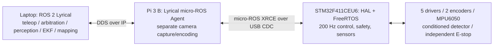

# Focused architecture audit

> **Historical micro-ROS implementation:** the active transport is now direct
> USB serial. See [current serial validation](../../../docs/DIRECT_SERIAL_VALIDATION.md). The results below
> describe the earlier micro-ROS path and do not validate the serial replacement.

This change implements the requested STM32 firmware target. It does not claim
that the existing laptop/Pi application graph has already been migrated to the
new motor contract. Existing workspaces and unrelated user edits are preserved.

| Area | Classification / evidence |
|---|---|
| Separate laptop/Pi ROS 2 workspaces | Implemented; `ros2_codebase/laptop_ws` and `pi_ws` |
| Perception, EKF, odometry, mapping on laptop | Existing placement reusable; actual deployment not checked |
| Original ROS 1 code | Retained under `catkin_ws`, `rpi_ws`; not compiled as ROS 2 firmware |
| Existing firmware | Mega-only AVR sketch and ASCII Pi bridge, incompatible with STM32/micro-ROS |
| Real-time MCU control | Missing before this change; C HAL/FreeRTOS target now cross-built |
| Motor driver details | Unverified: old source shows PWM+DIR, but no model/electrical datasheet or E-stop schematic |
| Existing Pi motor path | Needs retirement for STM32 deployment: optional Python GPIO PWM/setpoint conversion, not local deterministic MCU control |
| Existing Pi IMU | Needs retirement for STM32 deployment; MPU6050 acquisition/filter currently on Pi |
| Existing Pi video | OpenCV JPEG mock/real camera path; low-latency encoded separate stream still needs a separate migration |
| Agent | Missing before this change; matched source lock and minimal Pi deployment instructions provided, Pi execution pending |
| Watchdog and rearming | Mega has 500 ms output timeout but no full arming handshake; new STM32 core has 250 ms freshness stop and deliberate rearm |
| Five motor roles and two encoder associations | Mechanical mapping unverified; legacy code suggests four drive motors plus gripper, but current STM32 channel role is not asserted |
| Raw metal coil | Blocked: legacy code expects active-high digital front end, not a directly sampled passive coil |
| Local tests | New safety/PID/encoder and mocked HAL driver tests run with sanitizers |
| Lyrical client/Agent source compatibility | Same official Lyrical manifests and XRCE 3.0.2; client/Agent builds and live laptop USB link/restart verified, Pi deployment pending |
| Flash/debug | ARM artifacts built and flashed using USB HID after user isolated motor power and granted USB access; application CDC enumeration verified; no ST-Link attached |

## Remaining application work

The existing laptop teleop publishes `/cmd_vel` and numeric gripper commands;
existing odometry expects `/left_ticks` and `/right_ticks`; EKF expects
`/imu/data` orientation. The STM32 exposes bounded `/motor/setpoints`, paired
`/encoders/ticks` and raw `/imu/data_raw`. No automatic relay pretends these are
equivalent. Once mechanical mapping and calibration are known, update the
laptop arbiter/odometry/raw-IMU processing to consume the new contract directly.
Do not forward these through additional Pi application nodes.

The repository contains both teleop and a command demo, so command ownership
must be enforced in the eventual laptop bringup. Neither currently publishes
the STM32 motor message. No new executable automatically arms the robot.

## Hardware source audit result

Searches covered the original Mega sketch, its replacement Mega firmware, Pi
GPIO controller and YAML configuration, launch files, READMEs, and repository
hardware/data-sheet filenames. No L298/BTS/IBT/Cytron/TB6612/DRV-type model
reference or wiring schematic identifies the actual motor driver. The only
peripheral PDF documents are MPU6050 datasheets. Old platform pin numbers,
100 Hz Python PWM and digital motor signs are evidence of the old software,
not verified ratings or wiring for the user's new STM32. Those values have
not been copied into an energized STM32 configuration.
