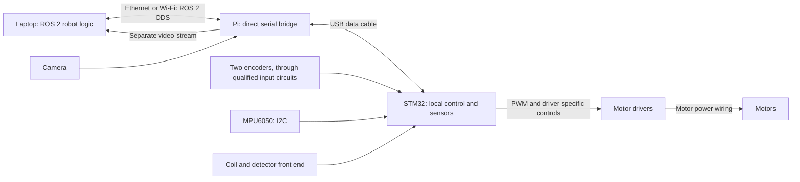

# Robot architecture and electrical-team handoff

> The active transport now uses direct USB serial with no micro-ROS agent.
> See [the serial protocol](SERIAL_PROTOCOL.md) and [current deployment](../../../docs/STM32_DEPLOYMENT.md).

This describes the proposed STM32 deployment, as of 2026-10-16. Only the
STM32 board is currently connected, through USB. No motors or sensors are
connected. Signal assignments below are a wiring plan; several electrical
interfaces still need approval. This document is not a completed power schematic.

## What runs where

| Device | Software and responsibility | How it is programmed |
|---|---|---|
| Laptop | ROS 2 Lyrical: joystick/teleop, command arbitration, motion-to-motor conversion, perception, odometry, IMU processing, EKF and navigation | Normal ROS workspace build and launch |
| Raspberry Pi 3 B | Linux, direct USB serial bridge, separate camera capture/encoding process | Install/build Linux applications; use a terminal or SSH |
| STM32F411CEU6 | C firmware: HAL hardware drivers, FreeRTOS tasks, local motor control, watchdog, sensor acquisition and direct USB serial | Compile firmware and flash it into the MCU |
| Motor drivers | Switch motor power according to control inputs | Must match the actual driver datasheet; not ordinary ROS nodes |



The Pi `stm32_bridge` maps the STM32's framed USB serial packets to the
ROS 2 network. It does not implement the motor controller. ROS callbacks on the
STM32 hand commands to the local control task; they do not directly drive pins.
The deployed STM32 plugs into a Pi USB host port. During development it can plug
into the laptop instead, with the Agent running on the laptop.

An STM32 is comparable to an Arduino: its program starts automatically from
flash after reset. HAL provides functions comparable to Arduino's GPIO/I2C
functions. Hardware timers generate PWM and count encoder edges. FreeRTOS
schedules separate tasks: control every 5 ms, sensors every 20 ms, and a lower
priority communication task. CubeIDE is the development environment; CubeMX's
`.ioc` records peripheral configuration. The board's USB bootloader can upload
firmware; an additional ST-Link probe enables SWD debugging and breakpoints.

## What has actually been demonstrated

- The C firmware was compiled for the STM32 and flashed
  using its existing USB bootloader.
- A matching ROS 2 Lyrical Agent ran on the laptop and received live status.
  Agent restart was tested without arming the board.
- The requested MPU6050 hardware offsets are included: accelerometer
  (-2789, -4452, 1391), gyroscope (97, -40, -51). A real connected sensor still
  needs validation.
- The current profile cannot arm, does not start PWM, and leaves the five PWM
  pins as inputs. Driver direction/enable pins remain unconfigured.
- The Pi deployment, real sensors, real motor drivers, energized motor operation,
  CubeIDE GUI import, and ST-Link debugging have not been physically tested.

The existing laptop teleop and odometry interfaces still need migration. Running
the old joystick launch does not command this STM32 firmware. The old Pi Arduino
bridge and Pi GPIO motor/IMU nodes are not the intended new deployment path.

## Power and signals are different wiring jobs

Conceptually, the electrical team must provide:

```text
Battery / source
  +-- protected motor power path, with independent E-stop action --> drivers --> motors
  +-- regulated electronics supply --> Pi, STM32 and sensor circuits

STM32 --> low-current logic signals --> drivers
Encoders / IMU / detector front end --> qualified logic or analog signals --> STM32
```

The exact power switching, braking/inhibit behavior, battery voltage, fuse
ratings, regulators and cable sizes require the actual component ratings. Motor
current must not flow through MCU pins or the Pi/STM32 power headers. Use a
qualified 3.3 V logic interface at the STM32; do not apply encoder supply voltage
to a GPIO. Ground/reference connections must follow the chosen nonisolated or
isolated interface design. Account for USB ground, USB power and possible
backfeeding when other supplies are connected. Route noisy motor currents away
from sensor/reference wiring.

## Signal allocation

`A0` on the board means STM32 `PA0`; these are port/pin names, not Arduino Mega
pin numbers. The PWM pin identifies a control signal to a driver, not a motor
power terminal. Confirm board header labels against the actual board schematic.

| Function | STM32 connection | Status / electrical condition |
|---|---|---|
| Motor 1 PWM | PA0 | User-selected; shares the WeAct KEY button circuit: resolve before use |
| Motor 2 PWM | PA1 | User-selected |
| Motor 3 PWM | PA2 | User-selected |
| Motor 4 PWM | PA3 | User-selected |
| Motor 5 PWM | PA8 | User-selected |
| Encoder 0 A / B | PA6 / PA7 | Chosen timer inputs; qualified input circuit required |
| Encoder 1 A / B | PB6 / PB7 | Chosen timer inputs; qualified input circuit required |
| MPU6050 SCL / SDA | PB8 / PB9 | Chosen I2C bus; pullups to 3.3 V; check existing breakout pullups |
| MPU6050 AD0 | GND | Selects address 0x68 |
| MPU6050 supply / ground | According to actual breakout schematic / system reference | Check regulator, voltage levels and module pin labels before wiring |
| E-stop auxiliary sense | PA4 | Normally closed auxiliary loop to ground; open/broken loop means STOP |
| Detector conditioned output | PA5 reserved | No raw coil connection; final analog/digital/frequency contract pending |
| USB | Board USB-C connector | Pi USB host in deployed robot; laptop for bench testing |
| ST-Link SWD | PA13 SWDIO, PA14 SWCLK, GND, target-voltage reference; NRST as needed | Reserve these pins; choose one reviewed target power arrangement |

If the selected drivers really use **PWM + DIR + independent ENABLE**, the
following additional pins are reserved as proposals:

| Motor | DIR proposal | ENABLE proposal |
|---|---|---|
| 1 | PB0 | PB3 |
| 2 | PB1 | PB4 |
| 3 | PB2 | PB5 |
| 4 | PB10 | PB14 |
| 5 | PB12 | PB15 |

Do not wire those proposals as a final design until driver models are known.
Other driver interfaces require a different binding/driver implementation. PB3
also uses the optional SWO trace function. Four PWM channels share TIM2, so
their frequency must be compatible. The fifth uses TIM1. No driver-supported
PWM frequency has been established.

## What each peripheral means

**Motors:** PWM is a repeating on/off logic signal. Duty is its on-time fraction.
A 50% duty command does not guarantee 50% motor speed. DIR selects direction
for a compatible driver; ENABLE/inhibit permits or prevents switching. The
driver switches the actual motor power. Safe inactive polarity, braking versus
coasting, reversal timing and maximum duty depend on the real driver and load.

**Encoders:** A and B are two pulse signals; their order indicates direction and
their count indicates rotation. Timer counting plus elapsed time yields speed.
The model string `YT06-OP-600B-6-24V-2M` does not establish output voltage,
conductor colors, pulses/revolution or receiver requirements. Obtain the exact
datasheet. Open-collector, push-pull and differential outputs need different
interface decisions. Verify actual counts per shaft revolution, sign and gear
ratio. Two encoders provide at most two independent feedback measurements;
five motors cannot each have an independent encoder PID with only two encoders.

**MPU6050:** I2C uses SCL (clock) and SDA (data), plus supply and reference ground.
Confirm the actual breakout's supply and pullups. Record sensor mounting axes.
Firmware reports acceleration and angular velocity, not a completed orientation
or position estimate. Calibration values belong to the calibrated sensor and
must be checked physically. Laptop processing must handle mounting and fusion.

**Metal detector:** A coil alone is not a defined microcontroller input. The
electrical team must supply the excitation/readout/protection circuit and define
its output. PA5 is reserved for a compatible conditioned analog or digital
output. A frequency output would need timer capture and possibly different pins.
The legacy code's digital input does not identify the missing front-end circuit.

**Emergency stop:** The hardwired circuit must inhibit motor energy/actuation
without requiring the STM32, Pi or ROS to work. PA4 merely reports the auxiliary
contact to software. Electrical stop behavior must be designed for the mechanism,
including any brake, gravity or stored-energy hazards.

## ROS/software contract

| Topic | Direction | Role |
|---|---|---|
| `/motor/setpoints` | Laptop to STM32 | Five bounded targets with explicit arming/session/freshness fields; normally 50 Hz |
| `/motor/status` | STM32 to laptop | Armed state, faults, validity and diagnostics, 20 Hz |
| `/encoders/ticks` | STM32 to laptop | Two cumulative encoder counts and speeds, up to 50 Hz |
| `/imu/data_raw` | STM32 to laptop | MPU6050 acceleration and angular velocity, up to 50 Hz |
| `/metal_detector/signal` | STM32 to laptop | Conditioned detector reading, up to 50 Hz |

Unconfigured or absent sensors do not publish invented zero readings. Custom
messages are in `ros2_codebase/interfaces/minesweeper_interfaces`. Use matching
Lyrical client/Agent dependencies, the same ROS domain and synchronized clocks.
The exact pinned Agent build is in `../gateway/README.md`.

The laptop still needs one command owner to convert `/cmd_vel` and other operator
requests into the motor contract. It also needs to adapt odometry to paired
encoder messages and process `/imu/data_raw`. Confirm motor roles before writing
that conversion; numbering alone does not define wheel position or function.

After hardware qualification, control can run every 5 ms. A missing stream of
fresh commands disarms after 250 ms, normally by the next control iteration.
An independent MCU watchdog resets a stalled controller in approximately one
second. Neither replaces the hardwired E-stop. Boot, reconnection and fault
recovery require deliberate arming; the present profile cannot arm at all.

## Information required from the electrical/mechanical team

Please return a schematic and a connection table containing:

1. Each motor's role, rated voltage, stall current, driver model/datasheet and
   terminal names. Include any magnet, brake, end stops or additional actuators.
2. Driver input voltage thresholds, truth table, enable/brake behavior, PWM
   frequency limits, safe reset states, external biasing, duty/current limits
   and safe reversal requirements.
3. Exact encoder datasheets, supply, output circuit, conductor identities,
   receiver/protection circuitry and association with motors/shafts.
4. Measured encoder counts per shaft revolution, sign, gearing, maximum speed,
   wheel dimensions and drive geometry needed for control and odometry.
5. MPU6050 breakout schematic or model, supply/pullups, and mounting orientation.
6. Metal detector circuit and its output voltage, units/meaning, timing and
   active polarity. A bare coil does not supply this interface.
7. Battery/regulator/protection/grounding design, USB power arrangement,
   independent E-stop circuit, and measured outputs during boot/reset/unplug.
8. Resolution of the PA0/KEY button conflict and confirmation that all proposed
   pins are physically available on this board.

## Joint bring-up order

1. Approve the schematic, interfaces and firmware bindings with motor power
   disconnected. Keep the commissioning profile while checking connections.
2. Verify supply voltages, logic levels, reset states and E-stop sense. Use a
   scope/logic analyzer to check actual PWM polarity, frequency and maximum duty
   in a reviewed test profile while motor power remains isolated.
3. Turn encoder shafts manually; measure count scale/sign. Validate stationary
   IMU readings and detector behavior with the actual front end.
4. Confirm inactive driver states during power-up, reset, unplug and firmware
   faults. Prove independent E-stop inhibition and deliberate rearm behavior.
5. Only after those checks, test one unloaded/secured motor at a time with
   electrical supervision and appropriate current limiting. Tune limits/PID
   using measured feedback, then validate loaded behavior.
6. Test laptop/Pi/USB loss and reconnection, command timeout and E-stop again on
   the real system. Deploy the Pi Agent and finish laptop topic migration.

See [HARDWARE.md](HARDWARE.md), [INTERFACES.md](INTERFACES.md),
[VALIDATION.md](VALIDATION.md), and [AUDIT.md](AUDIT.md) for implementation detail
and test evidence. Primary device reference:
[ST STM32F411 datasheet](https://www.st.com/resource/en/datasheet/stm32f411ce.pdf).
